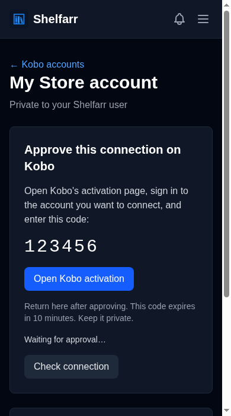
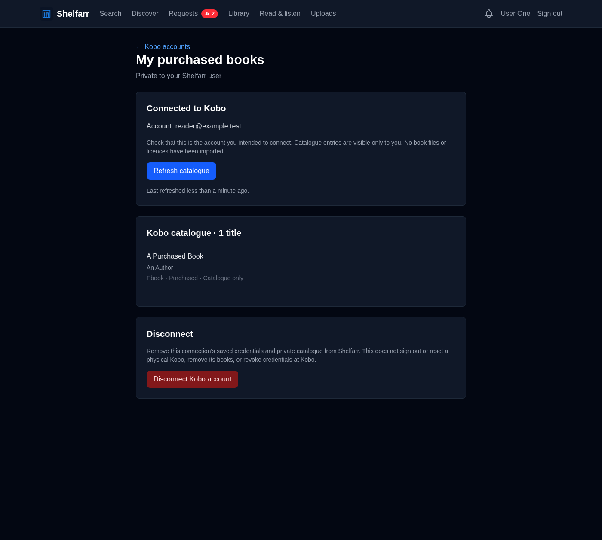

# Connect a Kobo Store account (preview)

Shelfarr users can connect their own Kobo accounts and inspect a private copy
of each account's book catalogue. This is the first step toward account-owned
libraries and explicit sharing. It does not change a physical Kobo's account,
configuration, books, or reading positions.

## Connect and test

1. Open **My Profile → Kobo accounts** in Shelfarr.
2. Give the connection a name and select **Connect Kobo account**.
3. Open **Kobo activation**, sign in on Kobo's own website, and enter the code
   shown in Shelfarr. Do not put your password, activation code, or account
   tokens in a support message.
4. Return to Shelfarr. It checks for approval every five seconds while the
   page is open. **Check connection** also works without JavaScript.
5. Check that the displayed Kobo account is the intended one. Shelfarr queues
   its first catalogue refresh automatically. Compare the titles with your
   Kobo library, including a known purchase, subscription or preview if any.
6. Use **Refresh catalogue** to fetch current metadata again. Large catalogues
   are paginated. A failed refresh leaves the last successful catalogue intact.

The approval code expires after ten minutes in Shelfarr. Start a new connection
if it expires or Kobo declines it. If saved credentials expire, connect the
account again; the previous catalogue remains visible until you disconnect it.
An unavailable job queue leaves the connection saved and offers a refresh retry.

Connections are owned by the signed-in Shelfarr user, including for admins.
Another user cannot view, poll, refresh, or disconnect them. Nothing is added
to the shared acquisition library, and there are no sharing controls yet.

Screenshots below use a synthetic test account and an example approval code:

## What this step does and does not test

This preview requests account authorization and catalogue metadata only. It
does not request content-access keys, download protected files, remove DRM,
purchase anything, or send Store books to a reader. A catalogue entry is not
evidence that a protected book can open on a different account's Kobo.

Reader delivery and Store coexistence remain separate work. The existing
[send-to-Kobo preview](kobo.md) still has its documented limitations. No Android
or iOS update is needed to use this web account-connection screen.

Before calling the account flow verified with real purchases, record a
successful approval, the correct account identity, a catalogue comparison,
refresh after restarting Shelfarr, and disconnect/reconnect. Do not record
credentials. These user-approved checks are separate from the automated
fixtures and unauthenticated live protocol checks.

## Protocol and operation

This uses Kobo's private reader activation protocol rather than a registered
third-party OAuth application or a physical reader. The public client profile
is the Aura ONE / platform 0373 profile used by existing clients. Authentication
occurs through `auth.kobobooks.com/ActivateOnWeb` and the scoped workflow poll
endpoint; the user approves on `www.kobo.com/activate`. Shelfarr exchanges the
resulting identity with `storeapi.kobo.com/v1/auth/device`, refreshes credentials
at `/v1/auth/refresh` when needed, and reads `/v1/library/sync`.

Protocol references:

- [Kobo's sign-in instructions](https://help.kobo.com/hc/en-us/articles/360044586534-Learn-how-to-create-and-sign-in-to-your-Kobo-account)
- [Existing reader activation client](https://github.com/subdavis/kobo-book-downloader/blob/main/kobodl/kobo.py)

Authentication, activation workflow, device identity, and email fields are
encrypted using Shelfarr's existing Active Record encryption configuration.
Keep the server's persistent encryption keys and database backups together.
These credentials authorize the account at Kobo; they are not read-only-scoped
credentials, even though Shelfarr currently uses only the catalogue operations.
They never appear in catalogue pages or API responses. Pending activation
codes appear only on their owner's no-store approval page.

Outgoing requests use only two fixed HTTPS hosts, do not use environment proxy
settings or browser cookies, and never follow redirects. A response cannot
choose an arbitrary poll host or library URL. Provider error bodies and account
tokens are not logged. Catalogue writes suppress SQL DEBUG bindings, matching
the existing private-library synchronization behavior.

A connection is limited to ten minutes for approval, polling is throttled on
the server, and transient polling failures back off. Each user can have up to
ten connections and start up to three in a minute. A catalogue fetch is bounded
to 100 pages, 20,000 distinct titles, 32 MiB of metadata, and three minutes of
network work. Repeated page cursors fail instead of looping. An unreadable or
incomplete response never replaces the saved catalogue. Unknown ownership or
media types are displayed as unknown rather than treated as purchases.

Optimistic locking prevents late sign-in, refresh, and catalogue responses from
reviving a disconnected account or overwriting a newer request. Jobs carry an
account id and a random request id, never provider credentials.

**Disconnect** deletes Shelfarr's connection credentials and catalogue. It does
not revoke the credential at Kobo or reset any Kobo device. Kobo's private
protocol can change; if approval fails, report the step and sanitized error
category, not an activation page, token, or raw provider response.
