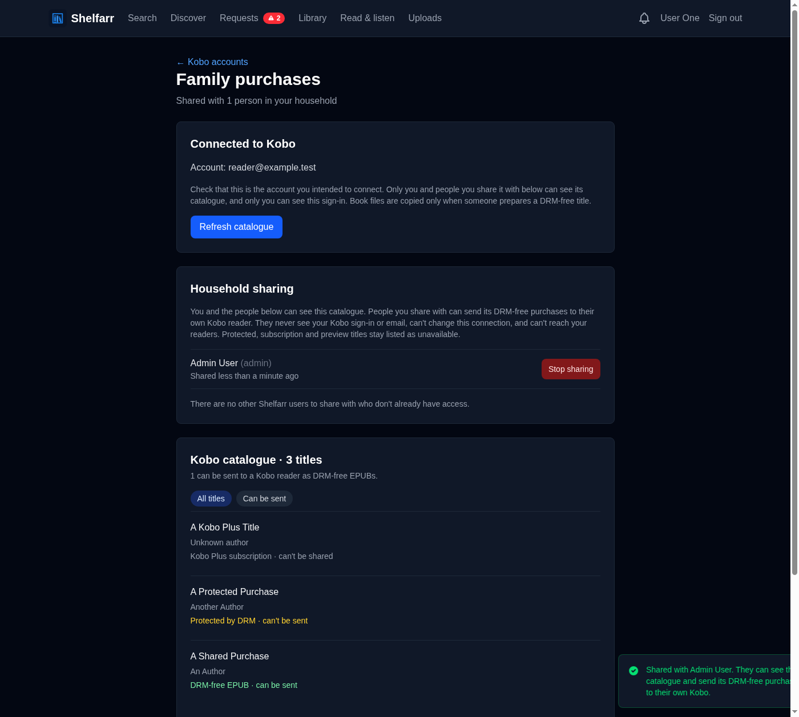
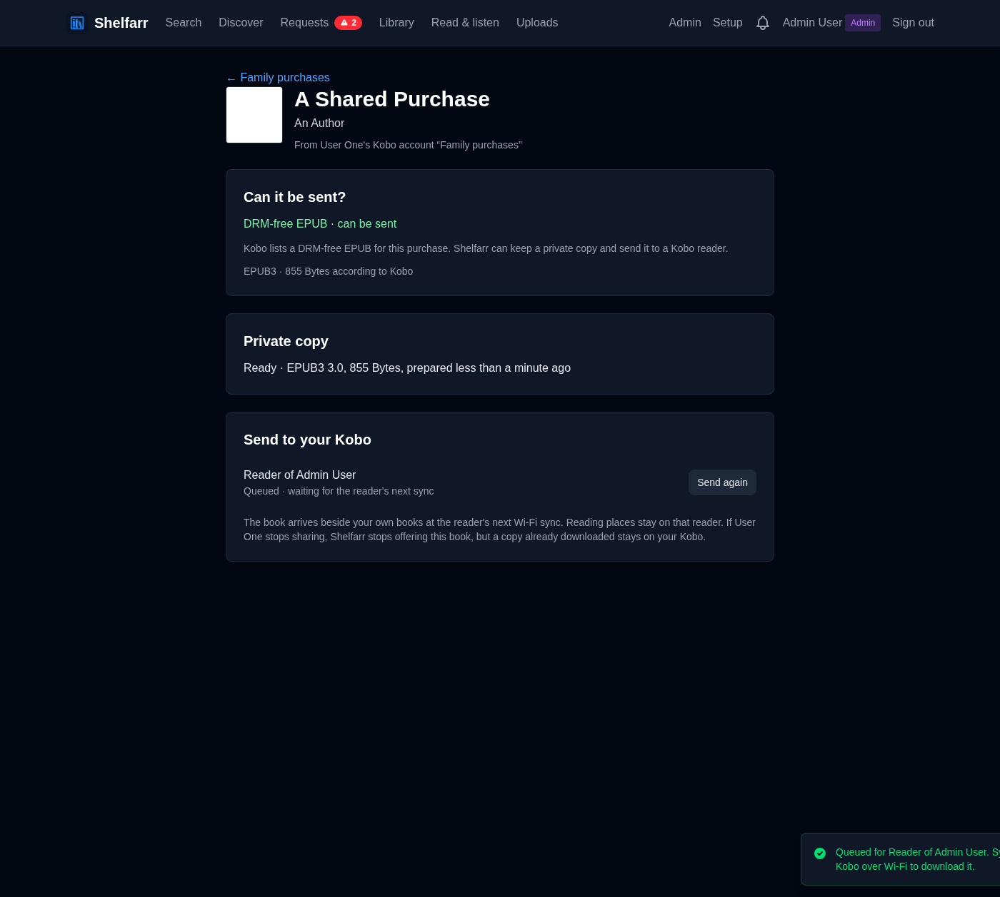

# Share Kobo purchases with your household (preview)

Each Shelfarr user can [connect their own Kobo account](kobo-accounts.md) and
choose people in the household who may see its catalogue. A person it is
shared with can send the account's **DRM-free** purchases to **their own**
stock Kobo reader through Shelfarr's [reader connection](kobo.md). Nothing is
shared until the owner chooses someone, and the owner can stop at any time.

## Share a catalogue (account owner)

1. Open **My Profile → Kobo accounts** and select your connected account.
2. Under **Household sharing**, choose a person and select **Share catalogue**.
3. The person now sees the catalogue under **My Profile → Shared Kobo books**
   (also listed on their **Kobo accounts** page).
4. **Stop sharing** removes their access immediately: they can no longer see
   the catalogue, prepare copies, or have Shelfarr deliver its books. Shelfarr
   removes their pending deliveries. A copy their Kobo already downloaded stays
   on that reader; Shelfarr cannot erase it, and does not send a removal.

Only the owner can share, stop sharing, refresh the catalogue, or disconnect.
People you share with never see your Kobo sign-in, email address or saved
credentials, cannot change the connection, and cannot reach your readers.
Admins have no special access to someone else's account.

## Send a shared book (recipient, or the owner)

1. Open the catalogue and use **Can be sent** to list eligible titles.
2. Open a title and select **Prepare copy**. Shelfarr downloads the DRM-free
   EPUB from Kobo with the owner's connection and keeps a private copy on the
   server. The page updates when the copy is ready (usually under a minute).
3. Choose **Send to [your reader]**, then tap **Sync** on that Kobo.

Readers listed are always your own. Add one in **Kobo readers** first if none
is connected; a reader keeps its own Kobo sign-in and the shared account is
never added to it. In Kobo Store coexistence mode the shared book arrives
beside your Store library. If the owner sends a book from their own account to
a reader signed in to that same Kobo account, the Store copy may also appear.

## What can be sent

Only a **purchased** ebook whose Kobo metadata offers a full EPUB or EPUB3
marked `SignedNoDrm`, from Kobo's download host, is eligible. That is the only
path verified to produce a DRM-free file. Every other title is listed with the
reason it cannot be sent:

| Catalogue label | Meaning |
|---|---|
| DRM-free EPUB · can be sent | Eligible |
| Protected by DRM · can't be sent | Kobo offers it only with Adobe or Kobo DRM |
| Format not supported | Only KEPUB, PDF, fixed-layout or an unverified DRM label |
| Kobo Plus subscription · can't be shared | A subscription title, not a purchase |
| Preview or sample · can't be shared | Not a purchase |
| Ownership not stated · can't be sent | Kobo did not say it was purchased |
| Not checked yet · refresh needed | Saved before this check; the owner can refresh |

Shelfarr never removes DRM, transfers content keys or licences, sends
protected books to another account's reader, treats a subscription or sample
as a purchase, buys anything, or changes Kobo account or device settings. The
copy is also checked when it arrives: a file that declares encryption, is not a
valid EPUB, or does not match Kobo's stated size is rejected.

## Privacy and safety

- **Explicit, revocable access.** Every page, prepare request, delivery, sync,
  metadata request, cover and file download checks the share again. A revoked
  share, a disconnected account, a deactivated owner or recipient, a title Kobo
  no longer lists as an eligible purchase, or a copy that is no longer ready all
  stop delivery, including download addresses a reader already received. A new
  share after revoking does not revive an earlier delivery.
  Locally issued entitlement UUIDs remain classified for that reader after
  revocation or disconnection, so later private bookmarks and cover requests
  cannot be forwarded to the Kobo Store. This record retains only the reader
  and random UUID, and is removed when the reader connection is deleted.
- **Not in the shared library.** Copies are never added to Shelfarr's library,
  search, requests or the web and mobile readers. They live in a private cache
  (`storage/kobo_account_cache`, or `KOBO_ACCOUNT_CACHE_PATH`) in directories
  only the server user can read, named only by database ids and the file's
  SHA-256 digest.
- **Bounded cache.** Each file is limited to 250 MiB and the cache to 4 GiB
  (`KOBO_ACCOUNT_CACHE_MAX_BYTES`). When full, the least recently used copies
  that no reader is waiting for are removed; copies a delivery still needs are
  never removed. A failed, incomplete or out-of-space download never replaces a
  copy that is already ready. Space is reserved before transfers start, across
  job workers; ready copies and in-flight reservations share the same bound.
  A download keeps its reservation for as long as its worker is running, even
  if the attempt times out or the account is disconnected meanwhile, so a slow
  transfer is never cleaned up for being slow. If a worker stops abruptly (for
  example, the server is killed), the next copy prepared removes its partial
  file, and any file it had not finished recording, before reserving space;
  that attempt is shown as incomplete and can be retried.
  A title being replaced keeps its earlier copy throughout the attempt, so a
  replacement may wait for enough room to stage both copies. Each user can
  request 20 copies an hour.
- **Fixed download hosts.** Shelfarr asks Kobo for a fresh signed link each
  time it prepares a copy and never stores or logs it. The download must start
  at `https://storedownloads.kobo.com` and may redirect only to
  `https://getbook.kobo.com`. No account credentials, cookies or environment
  proxy are used for the file transfer, and other hosts are refused.
- **Credentials stay with the owner.** Jobs carry only row ids and a random
  request id. The account's tokens remain encrypted as described in
  [Kobo accounts](kobo-accounts.md).
- **Reading places stay on the reader.** A shared copy is not a library
  edition, so a Kobo place in it is saved for that reader only and never
  applied to Shelfarr progress or to an unrelated library book.
- **Generations.** Each reader keeps a stable entitlement for a shared title.
  **Send again** after a newer copy is prepared offers the new file, with the
  same "previous edition" rules as library books. When Kobo lists a newer
  edition than the prepared copy, the book page says so.

Disconnecting an account removes its catalogue, prepared copies, shares and
everyone's pending deliveries of its books.

## Verification status

Automated tests cover the owner and recipient pages, permission checks at every
boundary (including revocation, soft-deleted users and issued download links),
eligibility classification, the fixed-host download with redirects, size,
encryption and disk-full failures, cache eviction and pinning, and reader sync,
download, cover and state endpoints against synthetic accounts and files.

A read-only check against a real connected account (68 catalogue records, six
purchased books advertising `SignedNoDrm` EPUB/EPUB3) downloaded and validated
one complete DRM-free EPUB through the same redirect chain, without sending
credentials. No real book has yet been shared with another person or synced to
a physical Kobo through this flow. Before removing the preview label, confirm on
a physical reader that a shared copy downloads, opens, survives a second sync,
and stops being offered after **Stop sharing**.
