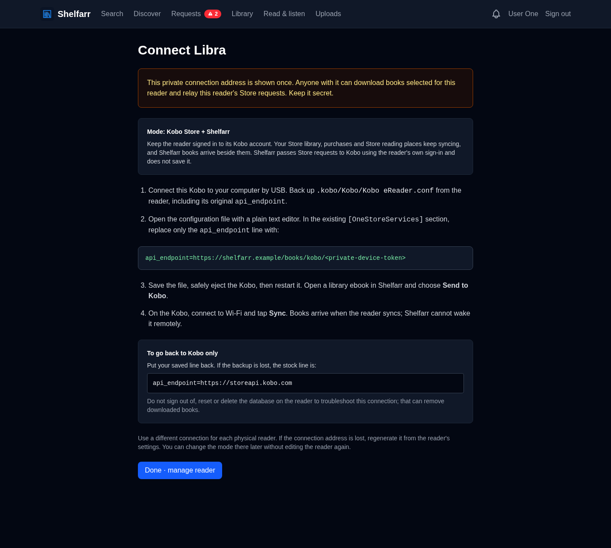
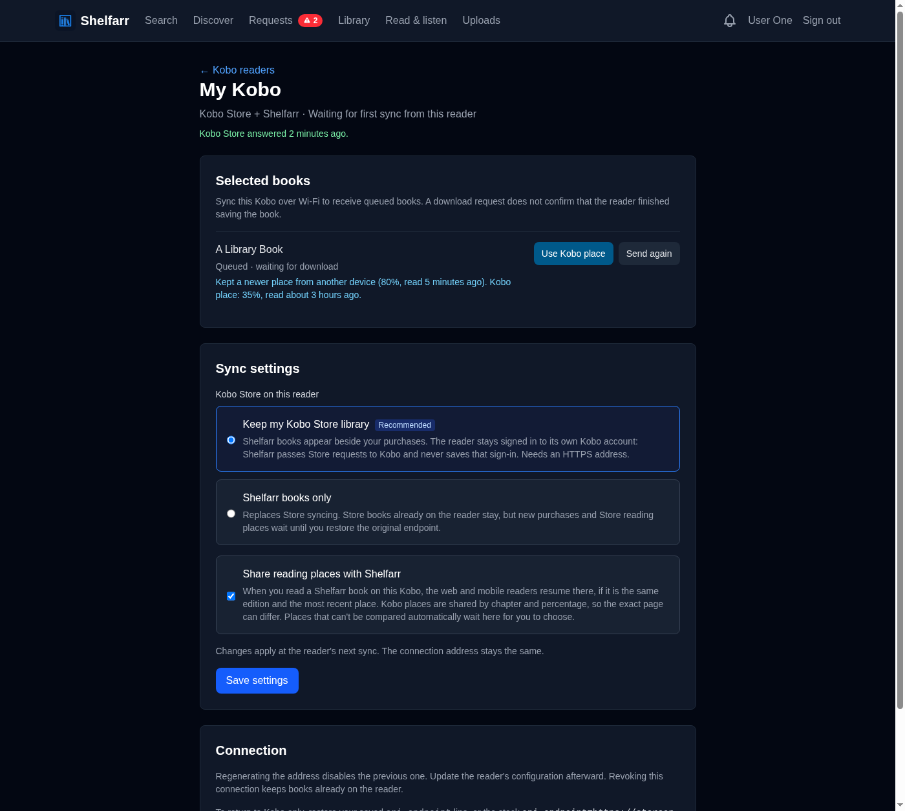

# Send ebooks to a stock Kobo (preview)

To connect a Kobo Store account and inspect its private catalogue, see
[Kobo accounts](kobo-accounts.md). That flow is separate from the readers
below: a connected account never signs in a reader, and a reader that keeps
its Kobo Store uses its own sign-in, not a Shelfarr account connection.

Shelfarr can serve selected library ebooks through the stock Kobo's Wi-Fi sync.
No KOReader, jailbreak, Kobo Cloud subscription, or new acquisition is needed.
Choose books separately for each physical reader. The reader fetches them when
you tap **Sync**; this is not an immediate push or a remote wake-up.

This is a protocol preview, not a claim that every Kobo generation has been
tested. The initial compatibility matrix is below. Kobo's private protocol and
firmware behavior can change. The integration follows the approach documented
by [Komga](https://komga.org/docs/guides/kobo/) and
[Calibre-Web](https://github.com/janeczku/calibre-web/wiki/Kobo-Integration).

## Before connecting

- Use a Kobo with stock software and a working Wi-Fi sync. Older devices that
  cannot reach an HTTP(S) endpoint or have no `[OneStoreServices]` configuration
  are not covered by this preview. Do not install another reader application.
- Use a Shelfarr address the device can reach. Include any deployment subpath.
  Browser-only sign-in gates (including Cloudflare Access) block the reader.
  Keep normal Shelfarr browser authentication enabled: the device URL provides
  its own narrowly scoped authentication.
- Prefer HTTPS with a certificate and TLS configuration your device trusts.
  Older firmware may require network/TLS troubleshooting. HTTP exposes the
  connection secret and book bytes; use it only on a trusted local network.
- Choose a mode for each reader (it can be changed later without editing the
  reader again):
  - **Keep my Kobo Store library** (recommended, needs HTTPS): Store purchases,
    collections and Store reading places keep syncing, and Shelfarr books arrive
    beside them. See [Kobo Store coexistence](#kobo-store-coexistence).
  - **Shelfarr books only**: replaces Store syncing. Downloaded Store books are
    left alone, but new purchases wait until the original endpoint is restored.
- Save the original endpoint. If the backup is lost, the stock line is
  `api_endpoint=https://storeapi.kobo.com`. Do not sign out, reset the reader,
  or delete its database as an integration troubleshooting step.

## Connect each reader

1. In Shelfarr, open **My Profile → Kobo readers**. Enter a recognisable name
   and the Shelfarr address reachable from that Kobo. Choose the Store mode and
   whether to share reading places.
2. Select **Create connection**. The private connection address appears once.
   It grants access to books selected for this reader; treat it like a password.
3. Connect the Kobo to a computer by USB. Back up
   `.kobo/Kobo/Kobo eReader.conf`, including the original `api_endpoint` value.
   Hidden files may need to be shown in your file manager.
4. In that file's existing `[OneStoreServices]` section, replace only the
   `api_endpoint` line with the exact line displayed by Shelfarr:

   ```ini
   [OneStoreServices]
   api_endpoint=https://shelfarr.example/kobo/<private-device-token>
   ```

5. Save, safely eject, and restart the reader. Open an acquired ebook in
   Shelfarr's **Library**, choose **Send to [reader]**, then tap **Sync** on Kobo.
6. Repeat with a separate connection for each reader. Sending to one reader
   does not select the book for another.

The connection URL cannot be recovered from Shelfarr. Use **Regenerate
connection address** if it is lost or exposed, then update the configuration.
The old address stops working and selected books remain selected. **Revoke
connection** removes device access and server-side selections. Neither action
deletes books already downloaded on the Kobo. Restore the original endpoint
on the reader to disconnect it fully.

## Supported files and status

- DRM-free EPUB and existing `.kepub`/`.kepub.epub` files, up to 250 MiB.
  Shelfarr does not convert EPUB to KEPUB. EPUBs declaring encryption (including
  font obfuscation) are rejected in this preview.
- Single-file library items and book-specific folders containing exactly one
  EPUB (up to five nested levels and 1,000 entries). Shared library-root folders
  and folders with multiple EPUBs must be disambiguated before sending.
- Copy and reference imports use the same root authorization as web downloads.
  Original library files are kept. PDFs, comics, audiobooks, remote-only owned
  library listings, and arbitrary filesystem paths are not sent.
- Metadata and embedded JPEG/PNG covers are served locally. Covers are bounded
  to 4 MiB and delivered at their embedded resolution. Missing covers do not
  prevent the ebook download.
- **Queued** means the book is selected for the reader. **Download requested**
  records a GET, not proof of a completed transfer or that the book was opened.
  Interrupted downloads support single HTTP byte ranges. Retry by syncing again.
- Replacing or editing a source file invalidates its queued download. Use
  **Send again** to publish the current file. A removed source cannot be fetched;
  no removal entitlement is sent to delete an existing reader copy.
- Reading state received from a Kobo is retained for that reader as sent. With
  **Share reading places with Shelfarr**, a supported place is also offered to
  the owner's shared progress; see [Shared reading places](#shared-reading-places).
  Read-along is not offered.

## Kobo Store coexistence

With **Keep my Kobo Store library**, Shelfarr answers only what it must to add
its selections and passes the reader's other Store requests to Kobo:

- Initialization is fetched from Kobo with the reader's own sign-in. Shelfarr
  replaces only library sync, library metadata, reading state and cover image
  addresses. Sign-in, Store browsing, purchases, wish lists, collections and
  every other resource keep Kobo's own address, so most Store traffic goes from
  the reader to Kobo directly.
- Library sync returns Shelfarr selections first, then the reader's own Store
  pages. One `x-kobo-synctoken` carries both positions; Kobo's part is
  encrypted (AES-256-GCM, a key derived from `secret_key_base`) and bound to the
  reader, its current connection address and a keyed fingerprint of its Kobo
  sign-in. Kobo never receives Shelfarr's cursor. A changed sign-in discards
  only the Store position and replays Store books; Shelfarr's position stays.
  A refreshed access token can therefore replay Store books too. Raw Store
  cursors and older unbound envelopes replay once rather than assuming an account.
- Metadata, reading state and other requests for Store books are relayed to
  `https://storeapi.kobo.com` only. Store covers redirect to Kobo's public image
  host. Shelfarr books stay local, and Store records can never remove, replace
  or change the state of a Shelfarr entitlement.
- The reader's Kobo `Authorization` header and device headers are forwarded for
  that request only and never stored. Cookies, forwarding headers and Shelfarr
  credentials are not relayed. Redirects, compressed or oversized responses and
  unexpected paths are refused; environment proxy settings are not used. Relayed
  responses are served as JSON or plain text with a sandboxing content policy.
- If the Store is unreachable, refuses the request or answers unexpectedly,
  the sync still returns Shelfarr books and keeps the previous Store position,
  so the next sync asks again. Nothing is deleted. A Store 401/403 on library
  sync, and any Store 4xx on initialization, is passed back unchanged so the
  reader recovers its own sign-in as it does with Kobo directly; Kobo answers a
  malformed sign-in with 400 rather than 401. The reader page shows the last
  Store outcome (answered, unreachable, refused, or sign-in requested).
- In this mode Shelfarr never issues placeholder sign-in tokens. In Shelfarr-only
  mode it still does (as before), and the reader page records when. A reader
  that received them may ask to sign in again after switching to coexistence;
  sign in with the same Kobo account. Signing in with a different account can
  remove that reader's downloaded Store books.

Coexistence uses the reader's own Kobo identity. It is unrelated to the
account connections in [Kobo accounts](kobo-accounts.md), and does not share
Store books between accounts or readers.

## Shared reading places

With **Share reading places with Shelfarr** (on by default for new readers,
off for readers created before this option), Kobo places in Shelfarr books
update the owner's progress for the web reader and the Android and iOS apps.

- Only a place Kobo names by chapter resource is shared. Kobo's `Source` can be
  a ZIP path, a package-relative path, or prefixed with the book's content ID
  (`<id>!!OEBPS/Text/ch.xhtml`, `<id>!OEBPS!Text/ch.xhtml`); it must match exactly
  one spine resource of the edition the reader downloaded.
- A file must have been requested through this reader's connection, still match its delivery
  fingerprint, and be the publication's current consumer asset. Before the
  first download, no place is shared. If the same entitlement has offered a
  replacement after a previous download, a bookmark cannot prove which copy it
  names: Kobo's state endpoint has no revision. Even a replacement GET is not
  proof that the reader installed it. These places require **Use Kobo place**
  and are never applied automatically. Earlier delivery records without this
  generation history use the same conservative rule. Check that the chapter
  and percentage fit the current file before choosing one.
- The saved locator is the chapter `href` with `progression` (Kobo's chapter
  percentage) and `totalProgression` (book percentage). This is the approximate
  cross-engine place described in the [consumer API](consumer-api.md#saved-progress).
  Kobo span and CFI values are never copied into the locator.
- The activity time is the bookmark's own `LastModified` (the reader's clock),
  never the sync or upload time. The normal compare-and-set rules apply: a later
  place from another device is kept, and the same Kobo place sent again is an
  idempotent retry rather than new activity.
- Places that cannot be compared automatically are kept on the reader page with
  their reason: no activity time, the reader's clock ahead of the server, an
  equal time with a different place, a saved place with no time, or an older
  place. **Use Kobo place** is an explicit choice: it saves the place with the
  time of the choice. Percentage-only places and unknown chapters are shown as
  not shareable.
- Places from other devices are not sent to the Kobo. A Kobo position needs
  Kobo's own span location, which Shelfarr cannot derive honestly.

## Deployment and secret handling

The stock protocol puts the device secret in `/kobo/<token>/…`, rather than a
standard bearer header. Shelfarr stores only its SHA-256 digest, shows the raw
value once in a `no-store` setup response, and filters the token from Rails'
request-path and parameter logs. Users who are soft-deleted lose device access.

Configure your reverse proxy, CDN, APM, error tracker, and access logs to redact
the token or exclude this route from URL collection. Shelfarr cannot sanitize
logs produced before a request reaches Rails. Do not paste an actual connection
URL into an issue, screenshot, analytics event, or support transcript. Book
download URLs include the same secret. All generated device links use the base
address saved at setup, not the Kobo's sometimes malformed Host header.

Rails logs only routing information for reader requests: no body or query
parameters, which can include Kobo account and device identifiers. In
coexistence the reader's Kobo bearer passes through your reverse proxy; do not
log `Authorization` headers there.

## Physical-device acceptance matrix

Automated tests cover legacy User-Agent handling, per-device authorization,
token rotation, replay/pagination, file changes, references, range/HEAD responses,
state isolation, embedded covers, and the browser setup/send flows. Coexistence
and shared places are covered against simulated Store responses. The relay
code was also run read-only against the live Store with a connected account's
credentials: initialization (181 resources, all overridden keys present, Kobo
sign-in kept), a three-page combined sync with the encrypted cursor (under
5 KiB) and an empty incremental sync, purchased-book metadata and reading state,
and Kobo image covers. Kobo rejects metadata requests for Kobo Plus subscription
entitlements with 400; that answer is relayed. Live bookmarks use `KoboSpan`
locations, the `Source` spellings above, and seven-digit fractional UTC times.
A physical reader has not yet synced through the relay.

Before removing the preview label, record the model and firmware of each test
reader and complete the following on the oldest, middle, and newest generation:

| Check | Oldest reader | Middle reader | Newest reader |
|---|---|---|---|
| Model and stock firmware version | Pending | Pending | Pending |
| Initialization and authenticated sync over actual network/TLS | Pending | Pending | Pending |
| EPUB 2 and EPUB 3 download, open, chapter navigation, cover | Pending | Pending | Pending |
| Existing KEPUB download and open | Pending | Pending | Pending |
| Second sync creates no duplicate or reading-position reset | Pending | Pending | Pending |
| Interrupted transfer resumes; file replacement + Send again | Pending | Pending | Pending |
| Sending to another reader leaves this reader unchanged | Pending | Pending | Pending |
| Rotate/revoke blocks old URL; restore saved Store endpoint | Pending | Pending | Pending |
| Coexistence: Store library, purchase sync and Store book opens beside Shelfarr books | Pending | Pending | Pending |
| Coexistence: token refresh, Store outage keeps Shelfarr books, mode switch | Pending | Pending | Pending |
| Shared places: KEPUB and EPUB place reaches web/app; older place offered | Pending | Pending | Pending |

No physical-device results have been recorded yet. In a failure report, include
model, firmware, whether HTTP/HTTPS and a subpath were used, the failing step,
and redacted Rails logs. Never include the token or Kobo account keys.

## Coexistence setup and place choices

These browser captures use synthetic test accounts and books. The private
connection address is replaced with a placeholder.




