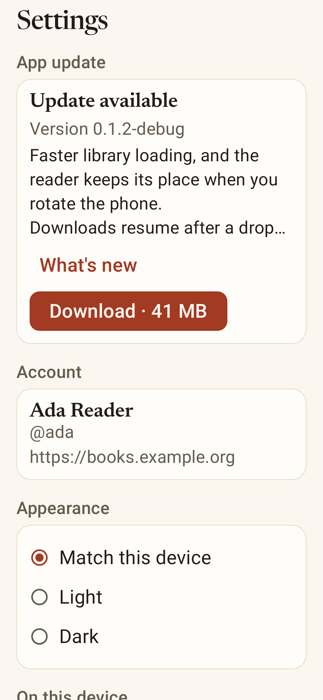
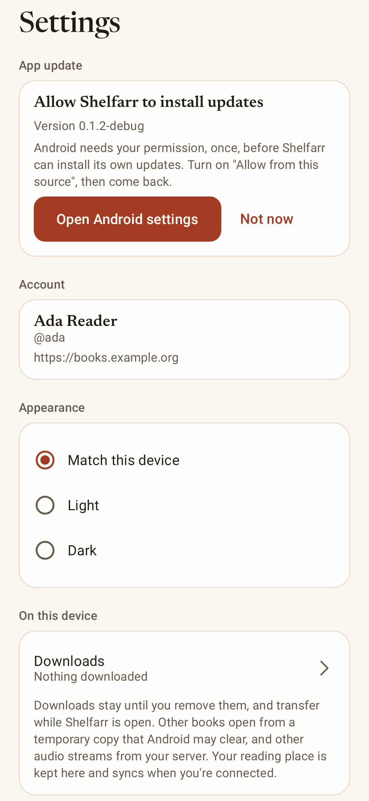

# Android in-app updates

A directly distributed Android build can find, download and install its own newer
versions using Android's normal installer. Updates normally come **from the Shelfarr
server the app is connected to**, which serves exactly the publisher's APK bytes from
its own cache. A feed fixed at build time remains as a fallback for servers from before
update discovery. Updating never uninstalls, re-signs or resets the app.

## Where updates come from

On each check the app picks one feed:

1. **The connected server's feed.** The app asks
   `GET <server>/api/consumer/v1/server.json` with no credential (its own HTTP client:
   no bearer token, cookies or cache). For this build's channel — `release` for release
   builds, `development` for debug builds — the server may name a feed:

   ```json
   {
     "schema_version": 1,
     "server_version": "2026.11.1",
     "consumer_api_versions": [1],
     "android": {
       "release": { "feed_url": "/apps/android/release.json", "download_page_url": "/apps/android" },
       "development": { "feed_url": "/apps/android/development.json", "download_page_url": "/apps/android?channel=development" }
     }
   }
   ```

   `feed_url` may be relative to the server (with or without its subpath) or absolute,
   but must resolve to an `https://` `.json` URL inside the server's own address —
   scheme, host, port and subpath — with no credentials, query, fragment, empty, dot or
   encoded dot/slash segments. The description and each redirect must stay inside that
   address too. The description may be at most 32 KiB.
2. **The built-in feed**, only when the server answers **404 or 410** (it predates
   discovery), or when no server is connected. Builds without one simply have no
   fallback.

A server that is unreachable, answers another error, or describes itself in a way the
app can't use **never moves updates to another publisher**: the feed chosen earlier for
that same server is used again, or the check fails (quietly, unless the person asked).
A server that describes itself but doesn't offer this build's channel offers nothing;
the built-in feed is not used then either. Plain-HTTP servers (debug builds on a LAN)
are never asked; they behave like a server from before discovery.

Everything offered, downloading or verified belongs to the feed and server it came from.
Signing in to another server, signing out, or the server naming a different feed drops
it (cancelling a download) and checks again; only an installation Android has already
started is left alone. A relaunch keeps a verified download only if the same server is
still in use. State written before discovery (the v3 updater) is read as belonging to
the built-in feed, so "Updated to …" still appears after updating from v3.

### Feed format (schema 1)

```json
{
  "schema_version": 1,
  "channel": "development",
  "package_name": "org.shelfarr.app.debug",
  "version_code": 4,
  "version_name": "2026.11.2-debug",
  "apk_url": "https://books.example.org/shelfarr/apps/android/development/4-<sha256>.apk",
  "size_bytes": 23484238,
  "sha256": "64 lowercase hex characters",
  "release_notes": "Optional plain text, at most 4000 characters.",
  "min_sdk": 26,
  "consumer_api_versions": [1]
}
```

- `schema_version` must be 1; `channel` must match the build; `package_name` must be the
  installed app's (`org.shelfarr.app` or `org.shelfarr.app.debug`).
- `version_code` is an unquoted integer from 1 to 2100000000; only one larger than the
  installed version is offered. `version_name` is 1–64 letters, digits, `.`, `_`, `+` or
  `-`, and must equal the APK's.
- `apk_url` must be `https://` on the feed's exact host and port, inside the feed's
  directory (subfolders allowed, so `…/apps/android/development/4-<sha>.apk` is fine
  for a feed at `…/apps/android/development.json`), end in `.apk`, and have no
  credentials, query, fragment, empty, dot or encoded dot/slash segments.
- `size_bytes` is 1 to 268435456 and `sha256` the whole APK's lowercase SHA-256.
- `consumer_api_versions` lists the consumer API generations the build speaks: a
  non-empty list of distinct whole numbers from 1 to 1000. **Required in a server's
  feed**; optional in the built-in feed, where leaving it out means generation 1. A
  build is offered only if it shares a generation with the server (the server's
  `consumer_api_versions`, or 1 when it doesn't say); otherwise Settings says it needs a
  newer server. This app speaks generation 1.
- `release_notes` and `min_sdk` are optional; unknown fields are ignored. The feed may
  be at most 64 KiB.

`apps/scripts/android-update-manifest.py` writes a feed from a built APK after checking
it with `apksigner` and `aapt2`.

## Building

| Property | Default | Meaning |
| --- | --- | --- |
| `shelfarrServerUpdates` | `true` | Ask the connected server for its feed. `false` with no built-in feed leaves the updater and its permission out |
| `shelfarrUpdateFeedUrl` | empty | Built-in fallback feed for **debug** builds, channel `development` |
| `shelfarrReleaseUpdateFeedUrl` | empty | Built-in fallback feed for **release** builds, channel `release` |
| `shelfarrVersionCode` | `2` | Version code, 1 to 2100000000. Must grow with every published build of a package |
| `shelfarrVersionName` | `0.1.1` | Version name (CalVer for published builds); debug builds append `-debug` |

A built-in feed URL must be `https://`, end in `.json`, sit inside a directory and carry
no credentials, query or fragment. Builds that can update themselves declare
`REQUEST_INSTALL_PACKAGES` and the installer status receiver.

Keep the current package ids and signing key. To keep the existing preview installs
updating, keep building debug previews with the same built-in feed they already have
(`-PshelfarrUpdateFeedUrl=…/downloads/android-development.json`) until every phone is
on a version with discovery.

## Behaviour

- **Checks.** On launch and foreground at most every 6 hours after a successful
  check, retrying a failed one after 30 minutes; after the signed-in server changes;
  and on demand from Settings.
- **Offer.** A newer release shows in Settings with its notes and size, and the
  Settings tab gets a small badge. Nothing blocks the library, reader or player.
- **Automatic downloads (opt-in).** Settings → Updates → "Download updates
  automatically", off by default and kept across updates (`auto_download_updates` in the
  app's preferences). When on, a successful check that finds a new release starts its
  download if the active network is unmetered (Wi-Fi and similar). It never installs and
  never pauses or interrupts reading or listening.
- **Download.** Into the app's private no-backup storage, over the updater's own client.
  Every redirect must stay on the feed's origin and directory over HTTPS. The file must
  not exceed the announced size and must match its length and SHA-256. It must then
  read, through PackageManager, as the installed package at exactly the announced,
  strictly newer version, signed by exactly the installed app's current certificates.
- **Install.** Only when asked. With audio playing, the app asks to pause first and
  never pauses on its own. Listening and reading places are saved, the file's hash and
  identity are checked again, and it goes to `PackageInstaller` with user action
  required, so Android always shows its own confirmation. Android verifies the APK
  signature itself. The first time, Android asks the person to allow installs from
  Shelfarr.
- **Outcomes and relaunch.** As before: cancelled, blocked or out-of-space installs keep
  the verified file; files Android rejects are deleted; a dropped session is noticed on
  return; the next launch after an update says "Updated to …" and removes the file.

## First install and the server address

A generic APK can't learn which server's page it was downloaded from (a directly
downloaded APK has no install referrer), and Shelfarr never builds or re-signs an APK
per server. So first installs are an honest two-step handoff:

1. On the server's `/apps/android` page (signed out is fine; `?channel=development`
   for previews), tap **Download**, and install the APK.
2. Return to the browser page and tap **Open Shelfarr**. That opens
   `shelfarr://connect?server=<percent-encoded https base URL including any subpath>`.
3. Shelfarr fills in the address and starts the usual browser approval. The approval
   screen names the server and shows the code; the person taps **Open browser** to
   approve. Nothing is typed.

The link carries only the server's public address, never a credential. The app accepts
it only from an `ACTION_VIEW` intent of exactly the shape above: scheme `shelfarr`, host
`connect`, no path, user info, port or fragment, one `server` field and nothing else,
and a value made of unreserved characters and `%XX` escapes (so `:` and `/` must be
encoded, as `encodeURIComponent` or `ERB::Util.url_encode` do). The decoded value must be
a plain `https://` address — host, optional port, optional path of unreserved
characters — with no credentials, query, fragment, `%` escapes, empty, `.` or `..`
segments, at most 2048 characters. Anything else is ignored. A sign-in started from a
link also requires the server's approval pages to be on that server's own HTTPS
address; otherwise it stops and asks the person to check the address.

What a valid link does depends on where the app is:

| State | Result |
| --- | --- |
| Signed out, nothing under way | Starts signing in to the linked server |
| Signing in to the same server | Nothing new |
| Signing in to another server | Explains; cancel that sign-in first |
| Signed in to the same server | Just opens the app |
| Signed in to another server | Explains; disconnect in Settings first (which removes that server's downloads) |
| Sign-in ended, same server | Starts signing in again, keeping its downloads |
| Sign-in ended, another server | Explains; nothing is switched automatically |

A link never signs out, replaces a saved connection, or erases anything. It works on
cold start and while running (`onNewIntent`); an explanation survives rotation; a link
not yet acted on survives activity recreation; reopening Shelfarr from Recents doesn't
repeat a link.

## Data across updates

**Platform guarantee.** Android updates an installed app in place, keeping its private
storage — `filesDir`, `noBackupFilesDir`, `cacheDir` (which Android may still clear for
space at any time), shared preferences — and its Android Keystore keys, which belong
to the app's Linux user id, when the new APK has the same package name, is signed by
the same certificate, and has a version code no lower than the installed one. Data is
lost only by uninstalling (or clearing data), which an update never does. A differently
signed APK is refused by Android rather than installed over the data.

**What the app adds.** Every later version must read the same places in the same way.
They are listed in `StorageLayout`, and must not change without a migration:

| What | Where |
| --- | --- |
| Session and pending sign-in (AES-GCM, Keystore key `shelfarr.session.v1`) | `noBackupFilesDir/secure/` |
| Updater state and verified APKs | `noBackupFilesDir/updates/` |
| Saved places and their outbox, downloads and their manifest, offline library | `filesDir/accounts/<accountKey>/` (`progress.json`, `downloads/`, `library.json`) |
| Appearance (by position: system, light, dark), reader settings, update choices | shared preferences `preferences` |
| Book copies and covers (disposable) | `cacheDir/epub`, `cacheDir/covers` |

`accountKey` is the first 16 bytes of SHA-256 over the normalized server address and
user id; normalizing (lowercase scheme and host, no trailing slash) is unchanged.

**Evidence.**

- `StorageLayoutTest` (JVM, every check) pins each name, the account key for fixed
  inputs, appearance ordering and an earlier version's reader-settings JSON, and reloads
  a session, a queued place and preferences through fresh objects. This is a
  simulation: Robolectric has no Keystore and no package update.
- `UpgradePreservationTest#aFreshStoreReadsTheSessionBack` (device, in
  `connectedDebugAndroidTest`) reads a session back through a new Keystore store
  instance on a real device: real Keystore, same process, no update.
- `apps/android/tools/upgrade-preservation.sh` (device; emulator only, it uninstalls
  first) is the real update: it builds the published v3 source (`1b99abe`), installs
  that older build, and seeds through the real app a
  Keystore session, dark appearance, reader settings, automatic downloads, a downloaded
  book and a place queued for an unreachable server; updates the package in place with
  `adb install -r` (a PackageInstaller session, same key, higher version code); then, in
  the new version's process, checks the same installation was updated (same
  `firstInstallTime`, later `lastUpdateTime`, higher version code) and that the session,
  account key, preferences, the book's bytes and manifest, and the queued place are all
  intact. It exercises Android's update path, not Shelfarr's own confirmation screen;
  that screen is Android's and needs a person.
- The updater's own steps up to `PackageInstaller` have unit and rendering coverage,
  including state saved by v3.

## Limits

- Signing-key rotation is not supported: an update must be signed with exactly the
  installed app's current certificate set.
- Partial downloads do not resume, and downloads run while the app is alive.
- Automatic downloads use Android's metered-network hint and the space check; they
  don't wait for charging.
- After installing, Android closes the app; reopening it is up to the person.
- The connect link can't be deferred through installation; the person returns to the
  page and taps Open Shelfarr.
- Installation itself, Android's confirmation and the upgrade script need a device or
  emulator; locally without KVM they are compiled, not run.

## Screens

These are fixture renders; version numbers illustrate a later available build.
The first screen uses enlarged system text.



